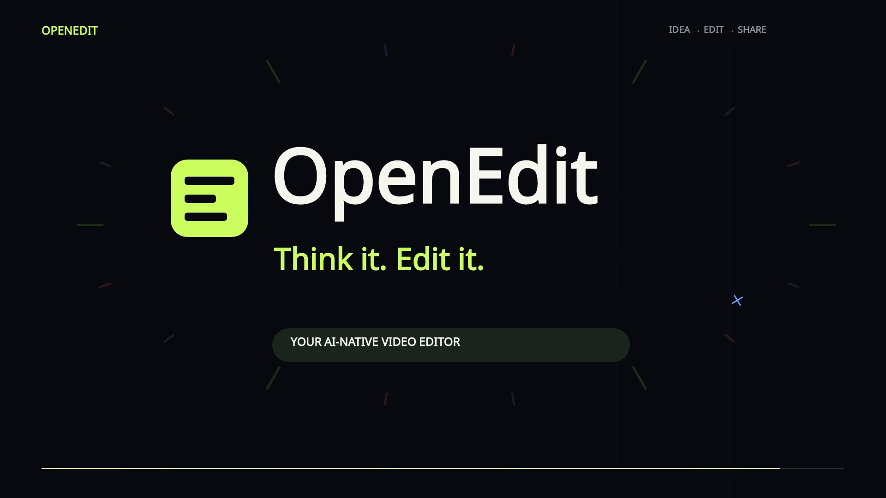

# Put your ideas in motion.

[Download the ten-second trailer](preview.mp4) or the
[editable OpenEdit project](openedit-kinetic-project.zip).

[](preview.mp4)

Original kinetic typography, flying film cards, a selected-region prompt,
animated timeline, export beat and logo burst. OpenEdit's live graphics canvas
and export dialog produced the verified 1920×1080, 60 fps H.264/AAC video.
Music and sound effects are separate, editable stereo tracks: an electro beat,
stereo sweeps, magnetic snap ticks, success chime and final logo impact.

`scene.jsx` is editable literal graphics source. `music.wav` and
`sound-effects.wav` are the two timeline stems; `score.wav` is their reference
mix. `sound-cues.json` records the major effect times. To regenerate the original
artwork and sound deterministically, run `author_trailer.py` using OpenEdit's
Python environment (NumPy is already a core dependency).

Using the installed environment's Python, create a new project:

```bash
/path/to/OpenEdit/.venv/bin/python create_project.py --project ~/OpenEditProjects/explainer
```

On Windows use `C:\path\to\OpenEdit\.venv\Scripts\python.exe` and an absolute
project folder. The script uses real MCP import/commit calls, requires the
installed graphics runtime, and refuses to reinitialize an existing project.
Open the project in the editor, select **Graphics** to scrub its animated layers,
and use **Export** for a new video. All clips and graphic layers stay editable.
Alternatively, extract the project ZIP into your OpenEdit projects folder
(normally `~/OpenEditProjects`). Keep its `.open_edit` directory intact. The ZIP
contains the saved editing history and imported audio, with render caches omitted.
Use the current OpenEdit build: this trailer needs the fix separating animation
keyframes from the 500-visual-layer limit.

The source/audio are original assets under the repository's MIT license. Font
rendering uses the package's OFL font. The
[new workflow log](../../docs/OPENEDIT_KINETIC_TRAILER_WORKFLOW.md) records the
actual authoring, refinements, checks and application fixes. The
[first version's workflow](../../docs/OPENEDIT_EXPLAINER_WORKFLOW.md) is retained.
